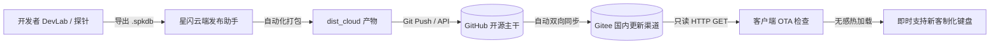

<div align="center">


# AstraFlux-HUB (星流外设控制中心)
### 通用磁轴与电竞外设开源控制中心 · 8000Hz 超高回报率 · 0.01mm 动态 Rapid Trigger · WebHID 纯净直连

**面向磁轴键盘与极速电竞外设打造的第三方现代化桌面控制中枢，支持热插拔即用、毫秒级调校与全量云端设备库。**

<p align="center">
  <a href="https://github.com/Kutaze/AstraFlux-Hub"></a>
  <a href="https://github.com/Kutaze/AstraFlux-Hub/releases"></a>
  <a href="https://gitee.com/Kutaze/astra-flux-hub"></a>
  <a href="LICENSE"></a>
  <a href="https://github.com/Kutaze/AstraFlux-Hub"></a>
  <a href="https://github.com/Kutaze/AstraFlux-Hub"></a>
  <a href="https://github.com/Kutaze/AstraFlux-Hub"></a>
  <a href="https://qm.qq.com/cgi-bin/qm/qr?k=7RG3iDSoQvmEPAic1ZzNYVLRObp4GZOK&jump_from=webapi&authKey=Xlf2ahwjHImCM02F6DctGvq6spka6sqGE3qLI/msv6ZsqKgaiOh5ol1IHVI0LmBI" target="_blank" rel="noopener noreferrer"></a>
</p>

<p align="center">
  <a href="https://github.com/Kutaze/AstraFlux-Hub/releases" target="_blank" rel="noopener noreferrer">
    
  </a>
  &nbsp;&nbsp;
  <a href="https://gitee.com/Kutaze/astra-flux-hub/releases" target="_blank" rel="noopener noreferrer">
    
  </a>
  &nbsp;&nbsp;
  <a href="https://qm.qq.com/cgi-bin/qm/qr?k=7RG3iDSoQvmEPAic1ZzNYVLRObp4GZOK&jump_from=webapi&authKey=Xlf2ahwjHImCM02F6DctGvq6spka6sqGE3qLI/msv6ZsqKgaiOh5ol1IHVI0LmBI" target="_blank" rel="noopener noreferrer">
    
  </a>
  &nbsp;&nbsp;
  <a href="#-赞赏与支持-sponsorship">
    
  </a>
</p>

<p align="center">
  <b>简体中文</b> • 
  <a href="#-多语言简介--multilingual-overview">English</a>
</p>

<p align="center">
  <a href="#-多语言简介--multilingual-overview">🌐 多语言简介</a> • 
  <a href="#-核心特性-core-features">✨ 核心特性</a> • 
  <a href="#-硬件矩阵与认证清单">🎮 硬件矩阵</a> • 
  <a href="#-安装与下载-download">📦 安装与下载</a> • 
  <a href="#-云端-ota-热更新架构">☁️ 云端 OTA</a> • 
  <a href="#-安全与硬件真实性铁律">🛡️ 硬件铁律</a> • 
  <a href="#-更新日志-changelog">📝 更新日志</a> • 
  <a href="#-社区交流与反馈-community--support">💬 交流反馈</a> • 
  <a href="#-赞赏与支持-sponsorship">💖 赞赏支持</a> • 
  <a href="#-star-history">📈 Star History</a> • 
  <a href="#-开发与构建指南">🚀 开发者指南</a> • 
  <a href="#-鸣谢与生态致敬-special-thanks">🤝 鸣谢致敬</a> • 
  <a href="#-免责声明与开源协议-license--disclaimer">📜 免责协议</a>
</p>

</div>

---

## 🌐 多语言简介 / Multilingual Overview

- **简体中文**：AstraFlux-HUB 是一款面向磁轴键盘与电竞外设的第三方现代化桌面控制中枢。采用 WebHID 纯净直连、突破 8000Hz 真实回报率与 0.125ms 极低输入延迟，赋能 0.01mm 级 Rapid Trigger 动态行程调校、SOCD 急停、DKS 与云端外设库即时热适配。
- **English**: AstraFlux-HUB is a next-generation open-source desktop control center for magnetic axis keyboards and competitive gaming peripherals. Built with pure WebHID direct link, true 8000Hz polling rate with 0.125ms ultra-low latency, 0.01mm-precision Rapid Trigger, SOCD, DKS, and instant cloud OTA device profile sync.

---

## ✨ 核心特性 (Core Features)

| 核心特性 | 技术亮点与优势 | 用户价值 |
| :--- | :--- | :--- |
| ⚡ **8000Hz 超高回报率** | 硬件级真实 8KHz 吞吐，0.125ms 极低输入延迟，消除传统 1000Hz 带来的微卡顿 | 极致跟手，射击与节奏游戏极速指令传递 |
| 🎯 **0.01mm 动态 Rapid Trigger** | 真正的 0.01mm 动态 AP/RP 死区调校，抬手即停、按压即发 | 瓦罗兰特 / CS2 急停拉枪快人一步，告别拖泥带水 |
| 🕹️ **专业电竞高级按键矩阵** | 深度集成 SOCD 急停优先模式（支持清空至 0 组防卡死）、DKS 四段行程、MT 双模瞬态 | 硬件板载参数直写，合规电竞宏命令随身携带 |
| 🌐 **WebHID 零驱动免常驻** | 系统级原生 HID 管道直通，不注入驱动服务、不驻留开机自启后台 | 纯净绿色，用完即关，0 内存 CPU 窃取 |
| ☁️ **云端 OTA 瞬时热更新** | 独创外设适配库热加载技术，新客制化星闪 PCB 秒级在线热适配 | 购买新键盘无需重装软件，一键检查即刻点亮 |
| 🎨 **深邃 RGB 发光与轴体标定** | 独立电竞发光层、全键磁通量死区校准、支持磁玉 Pro / 青龙马轴等主流曲线 | 视觉质感拉满，各配列轴体完美手感校准 |

---

## 🎮 硬件矩阵与认证清单

本项目已针对主流星闪方案磁轴键盘及客制化 PCB 展开深度真机适配与协议测试：

| 硬件型号 / PCB 方案 | 连接模式 | 回报率能力 | 默认轴体方案 | 适配认证状态 |
| :--- | :--- | :--- | :--- | :--- |
| **ES68** 旗舰磁轴键盘 | USB 极速有线 | **8000Hz** (板载 32K 硬件预留) | 磁玉 Pro / 磁琥珀 | 🟢 **官方深度认证** |
| **AE64-MAX** 客制化配列 | USB 极速有线 | **8000Hz** | 云端轴体库动态拉取 | 🟢 **官方深度认证** |
| **DV63** 青龙客制化磁轴 | USB 极速有线 | **8000Hz** | 青龙磁轴 (3.4mm 行程) | 🟢 **官方深度认证** |
| **通用星闪方案外设 PCB** | USB / WebHID | **8000Hz** 封顶安全值 | 全通用磁轴标准 | 🟡 **云端 OTA 持续更新** |

> 📌 更多第三方客制化星闪外设正通过社区探针不断扩充中，用户在设置页点击「检查云端更新」即可无感获取最新适配。

---

## 📦 安装与下载 (Download)

> 💡 **版本发布管理声明**：  
> 所有正式版本发布均统一托管发布至 **Releases** 页面。为确保软件的绝对稳定与硬件安全性，每一次版本更新必须经由**开发者进行真实硬件联调测试并由用户确认项目无误**后，方可发布至 Releases 页面；或由维护者通过本地发布工具安全推送。请广大玩家与开发者优先前往 Releases 页面下载经过完整校验的正式软件包。

### 1. 下载通道快速跳转

| 分发通道 | 适用网络环境 | 下载链接 | 说明 |
| :--- | :--- | :--- | :--- |
| 🚀 **GitHub Releases** | 国际 / 全球网络 (代码主干) | [👉 点击跳转 GitHub Releases 页面](https://github.com/Kutaze/AstraFlux-Hub/releases) | 完整发布包、便携包与源码历史归档 |
| ⚡ **国内高速 CDN 直链** | 国内网络 (极速免代理直连) | [👉 点击直接下载 V1.1.2 安装包](https://ghfast.top/https://github.com/Kutaze/AstraFlux-Hub/releases/download/v1.1.2/AstraFlux-HUB_Setup_v1.1.2.exe) | 基于 GitHub Release 专线 CDN 加速，跑满带宽 |

### 2. 最新版本发布包资产 (V1.1.2)

> 📦 **标准三文件封包规范**：发布包存放于 `安装包/V<Version>/` 独立目录中，包含更新日志、独立安装包及可直接上传至云端发布工具的 `manifest.json` 更新清单。

| 文件名 | 分发类型 | 文件大小 | SHA-256 校验哈希 |
| :--- | :--- | :--- | :--- |
| **`AstraFlux-HUB_Setup_v1.1.2.exe`** | 推荐 Inno Setup 官方向导 (最新 V1.1.2) | 93.49 MB | `b62fea864d81fee05d4c30fe0240735026a8d4c9f3019fbaf79af1dc08dc3cfb` |
| **`AstraFlux-HUB_Setup_v1.1.1.exe`** | 历史版本向导 (V1.1.1) | ~142 MB | `fb25d73678a3c87fadd0d57a44f7abb236411efd1b03842b81002362fc763ea6` |
| **`AstraFlux-HUB_Setup_v1.1.0.exe`** | 历史版本向导 (V1.1.0) | ~142 MB | `0c6d93ae99af667557fb625c50231fa9fcf2c31ff332d2b82cfa8ca21c2f29eb` |

* 💻 **便携版与绿色免安装**：安装向导内嵌完整免安装环境，亦可直接使用仓库中的 `软件本体/` 目录运行，纯绿色免安装。

---

## ☁️ 云端 OTA 热更新架构

AstraFlux-HUB 采用现代化的**双端分离 OTA 架构**，既保证了客户端的安全无特权，又赋能了客制化外设的高速迭代：



- **客户端绝无写入权限**：客户端仅发起公开只读 HTTP GET，绝不存储任何写入 Token，杜绝安全隐患。
- **配置直链 (物理隔离体系)**：
  - 外设适配库直链：`https://gitee.com/Kutaze/astra-flux-hub/raw/main/database/manifest.json`
  - 驱动软件更新直链：`https://gitee.com/Kutaze/astra-flux-hub/raw/main/software/manifest.json`

---

## 🛡️ 安全与硬件真实性铁律

> ⚠️ **所有 AI Agent 与二次开发者必须严格遵循以下硬件安全红线**：

1. **纯净 USB 有线纯粹性**：当前已认证机型（ES68 / AE64-MAX / DV63）均为纯 USB 极速有线键盘（内部无锂电池）。**严禁**在 UI 中渲染虚假的电量百分比、充电中或无线假状态。
2. **回报率真实封顶 8KHz**：星闪 SDK（`sdk-keyboard-v2`）枚举只开放到 `R8KHz`，**全软件严禁渲染 16K/32K 虚假选项**。
3. **高级按键允许全部清空**：支持用户逐条删除或一键清空至 0 组，**严禁**弹出拦截弹窗强制保留。
4. **弹窗防御规约**：禁绝原生浏览器 `alert()` / `confirm()` 阻塞式弹窗，全软件统一采用自研 `useToast()` 顶部平滑微光通知。
5. **硬件真实坐标隔离**：硬件底层的矩阵引脚与视觉显示坐标严格隔离，写入硬件后必须遵循 `GFSParamSave` 固化协议。

---

## 📝 更新日志 (Changelog)

> 💡 **同步说明**：主页更新日志同步跟随 [GitHub Releases](https://github.com/Kutaze/AstraFlux-Hub/releases) / [Gitee Releases](https://gitee.com/Kutaze/astra-flux-hub/releases) 进行维护与归档。

<details open>
<summary><b>📋 点击展开 / 折叠版本更新日志 (Changelog Archive)</b></summary>
<br/>

### [V1.1.2] - 2026-10-21
* 🐛 `[问题修复]`：精确对齐腾讯官方加群组件协议（群号：`1131310645`），修复参数大小写识别问题，全端支持一键唤起 QQ 加群。
* 🐛 `[问题修复]`：外设数据库更新与软件本体更新实现 100% 物理目录隔离（`database/` 与 `software/`），彻底杜绝仓库主分支清单混杂。
* 🐛 `[问题修复]`：优化客户端更新页检测逻辑，纠偏默认 OTA 地址，支持从 Gitee Releases 直接下载最新安装包执行覆盖更新。
* ✨ `[新特性]`：开发者云端发布工具新增「一键导入 SOP 安装包更新清单」功能，秒级自动装填版本号、直链、更新日志与哈希校验。
* 🚀 `[体验与性能]`：精简并加固客户端 OTA 与数据库加载链路，更新状态徽标常驻就绪。

### [V1.1.1] - 2026-10-21
* 🐛 `[问题修复]`：问题反馈直达 GitHub Issues 官方页面，标题与故障草稿自动复制并带参预填，无障碍跨端反馈。
* 🐛 `[问题修复]`：Gitee 分支对齐与自动纠偏机制，全面对齐 main 分支，保障国内节点 OTA 检测通畅。
* 🐛 `[问题修复]`：彻底解耦 `database/` (外设数据库) 与 `software/` (客户端软件更新) 目录，避免 OTA 检测路径冲突。
* ✨ `[新特性]`：软件顶栏右上角新增 QQ 官方技术交流群快捷入口（群号：`1131310645`），一键复制群号。
* ✨ `[新特性]`：首启动静默后台检查更新机制，并在更新按钮上根据云端版本动态展示醒目红点徽标。
* 🚀 `[体验与性能]`：统一外设数据库为 `.spkdb` 格式，支持开发者后台一键导出与更新页面一键导入/云端更新。
* 🛡️ `[安全与生态]`：确立版本发布 SOP 规范，规范版本递增、安装包「标准三文件」归档结构，并由 AI Agent 负责执行全流程发布。

### [V1.1.0] - 2026-10-21
* ✨ `[新特性]`：升级并固化 `V1.1.0` 统一版本号体系，确立大版本递增中间位、小版本递增末位规则。
* ✨ `[新特性]`：新增自动化发布打包流水线 (`npm run release:pack`)，支持一键在根目录输出安装包目录包含图形 Setup 安装程序。
* 🚀 `[体验与性能]`：仓库双端全面绑定：GitHub 负责开源存储与代码主干，Gitee 负责国内高速 OTA 渠道。
* 🛡️ `[安全与生态]`：确立版本发布「用户确认门禁」，每次发版在打包完成并经开发者测试确认前严禁擅自推送到远端仓库。
* 🛡️ `[安全与生态]`：全软件本地纯净运行，绝不搜集或上传任何击键与隐私数据，支持纯本地离线使用。

</details>

---

## 💬 社区交流与反馈 (Community & Support)

欢迎广大星闪外设玩家、电竞极客与客制化键盘创作者加入社区交流群！无论是日常使用疑问、磁轴手感与 RT 调校参数分享，还是新硬件 PCB 适配探针抓包，均可入群深入探讨。

<div align="center">

| 社区交流群 | 群号 | 一键跳转与加群组件 |
| :---: | :---: | :---: |
| 🐧 **AstraFlux-HUB 反馈交流** | **`1131310645`** | <a target="_blank" href="https://qm.qq.com/cgi-bin/qm/qr?k=7RG3iDSoQvmEPAic1ZzNYVLRObp4GZOK&jump_from=webapi&authKey=Xlf2ahwjHImCM02F6DctGvq6spka6sqGE3qLI/msv6ZsqKgaiOh5ol1IHVI0LmBI"></a><br/><br/>[👉 点击直接唤起 QQ 加群 (1131310645)](https://qm.qq.com/cgi-bin/qm/qr?k=7RG3iDSoQvmEPAic1ZzNYVLRObp4GZOK&jump_from=webapi&authKey=Xlf2ahwjHImCM02F6DctGvq6spka6sqGE3qLI/msv6ZsqKgaiOh5ol1IHVI0LmBI) |

</div>

> 📌 **进群交流须知**：  
> 1. 如遇到未识别的星闪键盘，可使用根目录下 `PCB信息枚举探针/星闪PCB适配探针.exe` 抓取设备指纹后在群内发送给开发者；  
> 2. 请遵守社区文明公约，文明交流，严禁发布商业广告与不良虚假内容。

---

## 💖 赞赏与支持 (Sponsorship)

如果 **AstraFlux-HUB** 为你的星闪磁轴键盘和电竞体验带来了便利与极致性能提升，欢迎通过以下渠道为作者提供支持与赞赏！你的每一份心意都是驱动项目持续演进与适配更多客制化 PCB 的源动力。

<div align="center">

| 微信赞赏 (WeChat Pay) | 爱发电 (Afdian) |
| :---: | :---: |
|  | <br/><br/>⚡ **爱发电平台维护中**<br/><br/><i>（主页正在维护升级中，暂未开放跳转，敬请期待）</i><br/><br/> |
| **一分钱也是爱 ❤️❤️ · 乐禾泽** | 感谢您的理解与耐心等待 |

</div>

> 💡 **特别说明**：本项目为纯粹的开源非盈利社区项目，无需购买任何激活码。官方交流渠道仅为上述 **QQ 交流群 (1131310645)** 与 GitHub Issues，未设立 Discord 社区，请注意甄别，谨防任何冒充官方人员索要费用的虚假信息。

---

## 📈 Star History

<div align="center">
  <a href="https://star-history.com/#Kutaze/AstraFlux-Hub&Date" target="_blank" rel="noopener noreferrer">
    
  </a>
</div>

---

## 🚀 开发者指南

### 1. 启动与日常调试
```bash
# 进入工程源码目录
cd 工程源码

# 启动前端开发调试（浏览器内调 UI）
npm run dev

# 启动 Electron 真机联合调试
env -u ELECTRON_RUN_AS_NODE npx electron --no-sandbox --disable-gpu --disable-software-rasterizer electron/main.js
```

### 2. 生产构建与安装包封装
```bash
cd 工程源码

# 1. 编译前端生产静态文件 -> dist/
npm run build

# 2. 原地更新解包与覆盖 app.asar（规避 Windows 文件锁）
npm run repack

# 3. 一键生成对应版本 Setup.exe 与 Portable 绿色包至 安装包_V<Version>/
npm run release:pack
```

---

## 🤝 鸣谢与生态致敬 (Special Thanks)

AstraFlux-HUB 的诞生离不开开源社区与星闪技术生态先锋者的无私分享。在此特别感谢以下项目与团队提供的协议探索与技术支撑：

* **[sparklinkplayjoy / keyboard-docs](https://github.com/sparklinkplayjoy/keyboard-docs)**：
  星闪外设 SDK 键盘标准协议文档与 API 规范参考，极大加速了本项目在底层 WebHID / 标准 HID 键值矩阵解析与指令下发方面的工程化实现。
  * 官方在线文档：[键盘 SDK 文档 \| 星闪悦动 (keyboardv2)](https://sparklinkplayjoy.github.io/keyboard-docs/keyboardv2/)
* **前端与桌面底层技术底座**：
  * [React 19](https://react.dev/) & [Vite](https://vitejs.dev/) - 现代化极致流畅的电竞响应式界面渲染
  * [Electron](https://www.electronjs.org/) - 跨平台硬件直连与原生能力桥接
  * [Tailwind CSS](https://tailwindcss.com/) & [Lucide Icons](https://lucide.dev/) - 高清暗色系极客视觉与交互图标系统

---

## 📜 免责声明与开源协议 (License & Disclaimer)

### 1. 开源协议
本项目源码完全基于 [MIT License](./LICENSE) 协议开源，允许自由使用、修改与衍生分发。

### 2. 免责与商标声明
1. **第三方属性**：本项目为第三方开源驱动控制中心，由开源社区爱好者独立研发与维护，与华为技术有限公司、星闪联盟 (NearLink / SparkLink Alliance) 或任何商业键盘品牌方均无官方隶属、合作雇佣或商业授权关系。
2. **商标权属**："NearLink"、"星闪"、各外设品牌名称及相关图形标识为各自所有者的注册商标或专属权利，文内引用仅用于硬件型号识别与客观兼容性陈述。
3. **硬件安全性**：软件已实施严格的参数边界保护（如回报率真实封顶 8000Hz、死区安全防撞红线等），但对于用户自行刷写第三方非官方固件、超频改装、或极端电压扰动引发的物理损坏，作者及社区贡献者概不承担任何法律连带责任。请始终在官方额定规格内合理调校设备。

<div align="center">
  <p>Made with ⚡ by <a href="https://github.com/Kutaze">Kutaze</a> and the Open Source Gaming Community.</p>
</div>
