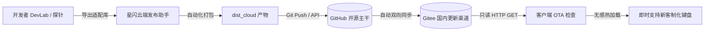

<div align="center">


# AstraFlux-HUB (星流外设控制中心)
### 通用磁轴与电竞外设开源控制中心 · 8000Hz 超高回报率 · 0.01mm 动态 Rapid Trigger · WebHID 纯净直连

**面向磁轴键盘与极速电竞外设打造的第三方现代化桌面控制中枢，支持热插拔即用、毫秒级调校与全量云端设备库。**

<p align="center">
  <a href="https://github.com/Kutaze/AstraFlux-Hub"></a>
  <a href="https://github.com/Kutaze/AstraFlux-Hub/releases"></a>
  <a href="https://gitee.com/Kutaze/astra-flux-hub"></a>
  <a href="LICENSE"></a>
  <a href="https://github.com/Kutaze/AstraFlux-Hub"></a>
  <a href="https://github.com/Kutaze/AstraFlux-Hub"></a>
  <a href="https://github.com/Kutaze/AstraFlux-Hub"></a>
</p>

<p align="center">
  <a href="https://gitee.com/Kutaze/astra-flux-hub/releases" target="_blank" rel="noopener noreferrer">
    
  </a>
  &nbsp;&nbsp;
  <a href="https://github.com/Kutaze/AstraFlux-Hub" target="_blank" rel="noopener noreferrer">
    
  </a>
  &nbsp;&nbsp;
  <a href="https://afdian.com/a/Kutaze" target="_blank" rel="noopener noreferrer">
    
  </a>
</p>

<p align="center">
  <b>简体中文</b> • 
  <a href="#-multilingual-overview">English</a>
</p>

<p align="center">
  <a href="#-多语言简介--multilingual-overview">🌐 多语言简介</a> • 
  <a href="#-核心特性-core-features">✨ 核心特性</a> • 
  <a href="#-硬件矩阵与认证清单">🎮 硬件矩阵</a> • 
  <a href="#-安装与下载-download">📦 安装与下载</a> • 
  <a href="#-云端-ota-热更新架构">☁️ 云端 OTA</a> • 
  <a href="#-安全与硬件真实性铁律">🛡️ 硬件铁律</a> • 
  <a href="#-更新日志-changelog">📝 更新日志</a> • 
  <a href="#-开发与构建指南">🚀 开发者指南</a> • 
  <a href="#-开源协议与社区声明">💖 免责声明</a>
</p>

</div>

---

## 🌐 多语言简介 / Multilingual Overview

- **简体中文**：AstraFlux-HUB 是一款面向磁轴键盘与电竞外设的第三方现代化桌面控制中枢。采用 WebHID 纯净直连、突破 8000Hz 真实回报率与 0.125ms 极低输入延迟，赋能 0.01mm 级 Rapid Trigger 动态行程调校、SOCD 急停、DKS 与云端外设库即时热适配。
- **English**: AstraFlux-HUB is a next-generation open-source desktop control center for magnetic axis keyboards and competitive gaming peripherals. Built with pure WebHID direct link, true 8000Hz polling rate with 0.125ms ultra-low latency, 0.01mm-precision Rapid Trigger, SOCD, DKS, and instant cloud OTA device profile sync.

---

## ✨ 核心特性 (Core Features)

| 核心特性 | 技术亮点与优势 | 用户价值 |
| :--- | :--- | :--- |
| ⚡ **8000Hz 超高回报率** | 硬件级真实 8KHz 吞吐，0.125ms 极低输入延迟，消除传统 1000Hz 带来的微卡顿 | 极致跟手，射击与节奏游戏极速指令传递 |
| 🎯 **0.01mm 动态 Rapid Trigger** | 真正的 0.01mm 动态 AP/RP 死区调校，抬手即停、按压即发 | 瓦罗兰特 / CS2 急停拉枪快人一步，告别拖泥带水 |
| 🕹️ **专业电竞高级按键矩阵** | 深度集成 SOCD 急停优先模式（支持清空至 0 组防卡死）、DKS 四段行程、MT 双模瞬态 | 硬件板载参数直写，合规电竞宏命令随身携带 |
| 🌐 **WebHID 零驱动免常驻** | 系统级原生 HID 管道直通，不注入驱动服务、不驻留开机自启后台 | 纯净绿色，用完即关，0 内存 CPU 窃取 |
| ☁️ **云端 OTA 瞬时热更新** | 独创外设适配库热加载技术，新客制化星闪 PCB 秒级在线热适配 | 购买新键盘无需重装软件，一键检查即刻点亮 |
| 🎨 **深邃 RGB 发光与轴体标定** | 独立电竞发光层、全键磁通量死区校准、支持磁玉 Pro / 青龙马轴等主流曲线 | 视觉质感拉满，各配列轴体完美手感校准 |

---

## 🎮 硬件矩阵与认证清单

本项目已针对主流星闪方案磁轴键盘及客制化 PCB 展开深度真机适配与协议测试：

| 硬件型号 / PCB 方案 | 连接模式 | 回报率能力 | 默认轴体方案 | 适配认证状态 |
| :--- | :--- | :--- | :--- | :--- |
| **ES68** 旗舰磁轴键盘 | USB 极速有线 | **8000Hz** (板载 32K 硬件预留) | 磁玉 Pro / 磁琥珀 | 🟢 **官方深度认证** |
| **AE64-MAX** 客制化配列 | USB 极速有线 | **8000Hz** | 云端轴体库动态拉取 | 🟢 **官方深度认证** |
| **DV63** 青龙客制化磁轴 | USB 极速有线 | **8000Hz** | 青龙磁轴 (3.4mm 行程) | 🟢 **官方深度认证** |
| **通用星闪方案外设 PCB** | USB / WebHID | **8000Hz** 封顶安全值 | 全通用磁轴标准 | 🟡 **云端 OTA 持续更新** |

> 📌 更多第三方客制化星闪外设正通过社区探针不断扩充中，用户在设置页点击「检查云端更新」即可无感获取最新适配。

---

## 📦 安装与下载 (Download)

软件提供「图形安装向导」与「绿色便携免安装」两种分发形式：

### 1. 最新发布包目录 (`安装包_V1.1.0/`)

| 文件名 | 分发类型 | 文件大小 | SHA-256 校验哈希 |
| :--- | :--- | :--- | :--- |
| **`AstraFlux-HUB_Setup_v1.1.0.exe`** | 推荐安装包 | ~141 MB | `0c6d93ae99af667557fb625c50231fa9fcf2c31ff332d2b82cfa8ca21c2f29eb` |
| **`AstraFlux-HUB_v1.1.0_Portable.zip`** | 便携免安装版 | ~140 MB | `af6b8469f9b5b236fe941551ff87541d5c381cc92e1ff76cab9749fbc7400a76` |

### 2. 下载通道导航
- 🚀 **国内首选 (极速秒下)**：[Gitee Releases 发布页](https://gitee.com/Kutaze/astra-flux-hub/releases)
- 🌐 **国际节点 (全量归档)**：[GitHub Releases 发布页](https://github.com/Kutaze/AstraFlux-Hub/releases)
- 💻 **本地运行**：如果使用便携版，解压后双击 `软件本体/AstraFlux-HUB.exe` 即可直接运行。

---

## ☁️ 云端 OTA 热更新架构

AstraFlux-HUB 采用现代化的**双端分离 OTA 架构**，既保证了客户端的安全无特权，又赋能了客制化外设的高速迭代：



- **客户端绝无写入权限**：客户端仅发起公开只读 HTTP GET，绝不存储任何写入 Token，杜绝安全隐患。
- **配置直链**：
  - 适配库直链：`https://gitee.com/Kutaze/astra-flux-hub/raw/master/device_db.json`
  - 版本清单直链：`https://gitee.com/Kutaze/astra-flux-hub/raw/master/manifest.json`

---

## 🛡️ 安全与硬件真实性铁律

> ⚠️ **所有 AI Agent 与二次开发者必须严格遵循以下硬件安全红线**：

1. **纯净 USB 有线纯粹性**：当前已认证机型（ES68 / AE64-MAX / DV63）均为纯 USB 极速有线键盘（内部无锂电池）。**严禁**在 UI 中渲染虚假的电量百分比、充电中或无线假状态。
2. **回报率真实封顶 8KHz**：星闪 SDK（`sdk-keyboard-v2`）枚举只开放到 `R8KHz`，**全软件严禁渲染 16K/32K 虚假选项**。
3. **高级按键允许全部清空**：支持用户逐条删除或一键清空至 0 组，**严禁**弹出拦截弹窗强制保留。
4. **弹窗防御规约**：禁绝原生浏览器 `alert()` / `confirm()` 阻塞式弹窗，全软件统一采用自研 `useToast()` 顶部平滑微光通知。
5. **硬件真实坐标隔离**：硬件底层的矩阵引脚与视觉显示坐标严格隔离，写入硬件后必须遵循 `GFSParamSave` 固化协议。

---

## 🚀 开发者指南

### 1. 启动与日常调试
```bash
# 进入工程源码目录
cd 工程源码

# 启动前端开发调试（浏览器内调 UI）
npm run dev

# 启动 Electron 真机联合调试
env -u ELECTRON_RUN_AS_NODE npx electron --no-sandbox --disable-gpu --disable-software-rasterizer electron/main.js
```

### 2. 生产构建与安装包封装
```bash
cd 工程源码

# 1. 编译前端生产静态文件 -> dist/
npm run build

# 2. 原地更新解包与覆盖 app.asar（规避 Windows 文件锁）
npm run repack

# 3. 一键生成对应版本 Setup.exe 与 Portable 绿色包至 安装包_V<Version>/
npm run release:pack
```

---

## 📝 更新日志 (Changelog)

### [V1.1.0] - 2026-10-21
* ✨ `[新特性]`：升级并固化 `V1.1.0` 统一版本号体系，确立大版本递增中间位、小版本递增末位规则。
* ✨ `[新特性]`：新增自动化发布打包流水线 (`npm run release:pack`)，支持一键在根目录输出 `安装包_V1.1.0/` 包含图形 Setup 安装程序与 Portable 绿色便携包。
* 🚀 `[体验与性能]`：仓库双端全面绑定：GitHub 负责开源存储与代码主干，Gitee 负责国内高速 OTA 渠道。
* 🛡️ `[安全与生态]`：确立版本发布「用户确认门禁」，每次发版在打包完成并经开发者测试确认前严禁擅自推送到远端仓库。
* 🛡️ `[安全与生态]`：全软件本地纯净运行，绝不搜集或上传任何击键与隐私数据，支持纯本地离线使用。

---

## 💖 免责声明与开源协议

1. **开源协议**：本项目基于 [MIT License](./LICENSE) 协议完全开源。
2. **免责与商标声明**：本项目为第三方开源社区软件，与华为技术有限公司、星闪联盟 (NearLink / SparkLink Alliance) 或外设硬件品牌方无商业附属关系。相关硬件协议、固件与品牌商标归原权利人所有。

<div align="center">
  <p>Made with ⚡ by <a href="https://github.com/Kutaze">Kutaze</a> and the Open Source Gaming Community.</p>
</div>
