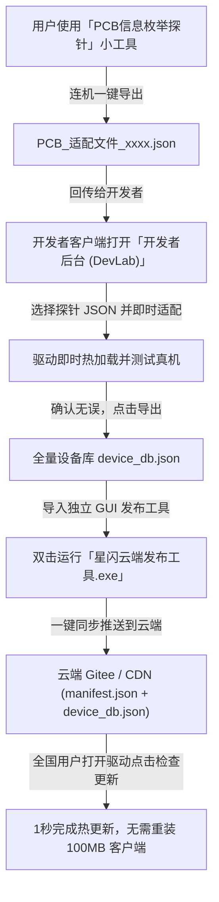

# 星闪悦动驱动 - 开发者云端发布与国内免费 OTA 搭建指南

## 一、为什么绝对不在客户端写死 API 密钥？（安全原则）
根据您的安全指示，分发给普通用户的客户端驱动程序（`星闪悦动HUB`）具有以下安全特性：
1. **纯客户端只读模式 (Read-Only GET)**：客户端内部**没有任何**云平台写权限、上传密钥或个人 Access Token，黑客与逆向爱好者无法通过反编译客户端窃取您的云端账号。
2. **直链可配置**：云端下载直链 (`manifestUrl`) 保存在本地持久化配置中，开发者在后台随时替换，客户端仅定期 GET 下载清单与比对版本。
3. **独立发布工具隔离**：本发布工具（位于 `开发者云端发布工具/` 目录）仅存放在开发者本人电脑中，绝不随驱动客户端对外分发。

---

## 二、国内免费云端推送推荐方案（告别 GitHub 国内打不开）

由于 GitHub 在国内经常遭遇 DNS 污染或无法访问，推荐使用以下国内免费高速渠道：

### 推荐方案 A：Gitee（码云）公开仓库（最推荐，全自动化）
- **特点**：国内服务器，访问极速，提供官方 API，且永久免费。
- **搭建步骤**：
  1. 打开 [Gitee.com](https://gitee.com) 注册登录；
  2. 点击右上角「+」->「新建仓库」：
     - 仓库名称：`sparklink-hub-releases`
     - 是否开源：**公开**
     - 初始化仓库：勾选「生成 Readme 文件」
  3. 获取个人私人令牌 (Access Token)：
     - 点击右上角头像 ->「设置」-> 左侧菜单「安全设置」->「私人令牌」；
     - 点击「+ 生成新令牌」，权限勾选 `projects`（项目与代码仓库）；
     - 复制生成的 Token；
  4. 配置本发布工具：
     - 打开 `开发者云端发布工具/config.json`；
     - 填入您的 `owner`（用户名）、`repo`（仓库名）和 `accessToken`；
  5. 以后只需将 `device_db.json` 放进此目录，双击 `一键生成与发布.bat` 即可全自动秒级发布！
  6. 复制 Gitee 提供的 Raw 直链填入客户端「开发者后台」：
     `https://gitee.com/<用户名>/sparklink-hub-releases/raw/master/manifest.json`

---

### 推荐方案 B：国内免费网盘 / 直链（123云盘 / 蓝奏云 / 夸克）
- 若您希望直接把打包好的安装包挂在网盘：
  - 123云盘与蓝奏云均支持直接生成下载直链；
  - 您只需在 `config.json` 的 `appDownloadUrl` 处填入该直链；
  - 库文件 `device_db.json` 亦可直接在 QQ 交流群或贴吧发给用户，用户在驱动设置页点击「导入离线适配库 (.json)」即可一秒导入。

---

### 推荐方案 C：阿里云 OSS / 腾讯云 COS / 七牛云（企业级极速 CDN）
- 存放几十 KB 的 `device_db.json` 和 `manifest.json`，每月流量费用通常低于 0.1 元。
- 直接绑定自定义域名开启 HTTPS 直链。

---

## 三、真机适配到云端发布的完整工作流

---

## 四、独立 UI 工具使用说明 (星闪云端发布工具.exe)

本目录下已打包生成纯绿色独立单文件 EXE：[`星闪云端发布工具.exe`](file:///d:/desk/星闪悦动驱动/开发者云端发布工具/星闪云端发布工具.exe)

### 核心特性：双独立发布通道
工具顶部提供两个独立专业窗口，同时支持右上角点击 **「🗗 独立双窗口」** 并在多显示器上并排双开运行：

1. **【⌨️ 键盘数据库更新推送】**（外设适配库秒级热更新）：
   - 专用于新客制化键盘/PCB 档案的分发；
   - 拖拽 `device_db.json` 或真机探针导出的 `PCB_适配文件_xxxx.json` 进窗口，自动解析出所有 PCB 的 VID:PID、配列、灯珠数量、空格多灯位等关键硬件参数；
   - 一键将最新 `device_db.json` 推送到云端，并同步更新清单，**全国用户端秒级拉取适配，无需重新安装客户端**。

2. **【🚀 软件版本更新推送】**（驱动客户端安装包覆盖升级）：
   - 专用于发布驱动客户端新版安装包 (`SparkLinkHub_Setup_V1.4.0.exe`)；
   - 支持拖拽本地安装包文件自动读取大小与文件名，支持填写网盘/Gitee Release 直链；
   - 自带 **「⚡ 测试直链有效性与大小」** 探针，防止直链填错或失效；
   - 支持设置更新说明（Changelog）与升级策略（推荐升级 / 重要覆盖更新）；
   - 一键推送后，**全国用户的客户端将自动检测并弹出覆盖安装提示**。

3. **全量数据库导出与绿色一键补丁 (.bat)**：
   - 两个窗口无缝共享 Gitee 仓库配置与私人令牌，配置一次永久生效；
   - 底部内置深色控制台实时显示 API 提交与校验日志；
   - **「📁 导出本地设备库」**：导出合并后的全量 `device_db.json` 与 `manifest.json`，可上传至 123云盘/蓝奏云/QQ群；
   - **「⚡ 导出绿色升级安装包 (.bat)」**：一键生成纯绿色自动升级脚本（内嵌全量硬件数据库 Base64 及本地文件互锁检测）。用户无需安装，双击该 `.bat` 即可自动关闭驱动、自动识别 AppData 路径并瞬间覆写最新高版本硬件库，重新打开驱动即刻生效！

### 快捷入口说明：
- 在驱动客户端的【其他设置】或【关于】页面，**连续点击版本号 7 次**（或在键盘上按 `Ctrl+Alt+Shift+D`），即可呼出「开发者后台 (Dev Lab)」。
- 开发者后台默认解锁密码：`sparklink2026`。
- 在后台的「云端更新直链配置」中输入您的 `manifest.json` 下载直链并点击「保存直链」，即可实现全国用户的云端 OTA 闭环！
- 用户端无网/离线更新：直接在客户端设置页点击「导入离线适配库 (.json)」选取 `device_db.json`，或直接双击运行绿色补丁脚本 `星闪键盘数据库一键更新补丁_Vxxxx.bat`。
